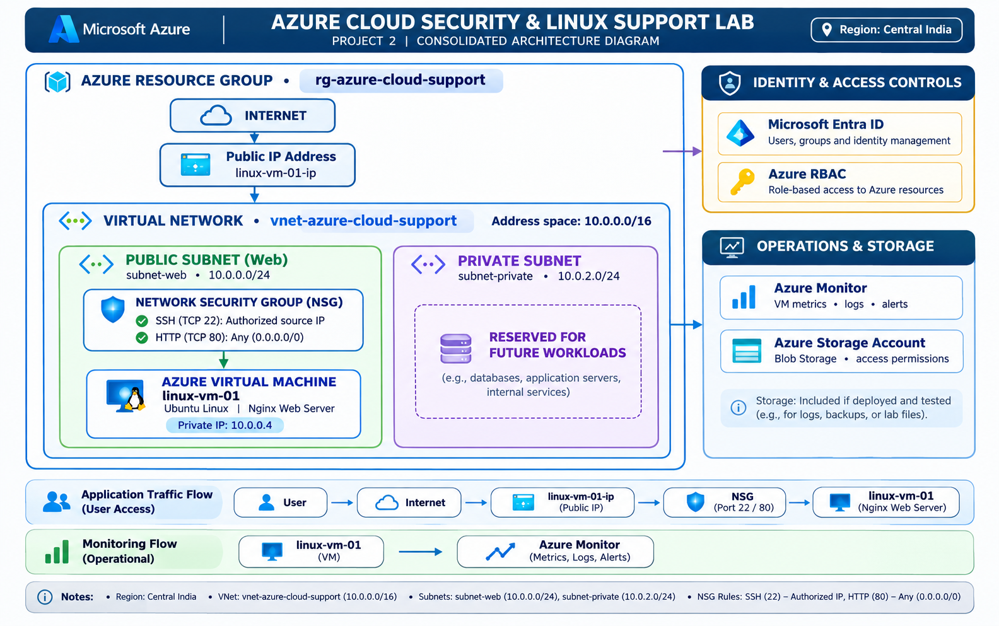

# Azure Cloud Security & Linux Support Lab

## Overview

This project is a hands-on **Microsoft Azure Cloud Security and Linux Support Laboratory** designed to develop practical skills in cloud infrastructure, Linux administration, networking, web server configuration, identity and access management, monitoring, troubleshooting, and basic automation.

The lab was completed through a structured **12-day practical project** using Microsoft Azure and an Ubuntu Linux virtual machine.

The project covers:

- Azure resource groups and virtual networks
- Azure Virtual Machines
- Ubuntu Linux administration
- SSH configuration and troubleshooting
- Network Security Groups (NSGs)
- IP addressing and routing
- DNS and network connectivity
- Nginx web server installation and configuration
- HTTP and HTTPS
- Linux users, groups, and permissions
- Linux processes and services
- CPU, memory, disk, and log troubleshooting
- Azure Monitor metrics and alerts
- Microsoft Entra ID
- Azure Role-Based Access Control (RBAC)
- Azure Storage Account and Blob Storage
- Bash health-check automation

The goal was to gain practical experience relevant to entry-level roles such as:

- Azure Cloud Support Associate
- Cloud Support Engineer
- Linux Support Engineer
- Cloud Operations Associate
- Junior Cloud Engineer
- Junior Cloud Security Engineer
- Technical Support Engineer

> **Note:** Troubleshooting scenarios were controlled lab exercises designed to simulate common cloud infrastructure, Linux, networking, and security problems.

---

# Project Architecture

### Architecture Diagram



### Azure Environment

| Configuration | Value |
|---|---|
| Cloud Provider | Microsoft Azure |
| Azure Region | Central India |
| Resource Group | `rg-azure-cloud-support` |
| Virtual Network | `vnet-azure-cloud-support` |
| Subnet | `subnet-web` |
| Virtual Machine | `linux-vm-01` |
| Operating System | Ubuntu Linux 24.04 |
| VM Size | Standard B2ats v2 |
| Private IP | `10.0.0.4` |
| Public IP Resource | `linux-vm-01-ip` |
| Network Security Group | `nsg-azure-cloud-support` |
| Web Server | Nginx |
| SSH Port | 22 |
| HTTP Port | 80 |
| HTTPS Port | 443 |

**Network note:** The VM's routing output showed the local network as `10.0.0.0/24`. The exact VNet and subnet configuration should be verified in Azure before documenting any additional address ranges or private subnets.

### Network Design

```
                  INTERNET
                      |
                      |
               Public IP Address
                linux-vm-01-ip
                      |
                      |
               Network Security
                Group (NSG)
                      |
                      |
              Azure Virtual Machine
                  linux-vm-01
                 Ubuntu Linux
                      |
                      |
                    Nginx
                 HTTP / HTTPS
```

### Security Configuration

| Rule | Port | Access |
|---|---:|---|
| SSH | TCP 22 | Authorized source IP |
| HTTP | TCP 80 | Any (0.0.0.0/0) |
| HTTPS | TCP 443 | Configured and tested during the lab |

SSH access was restricted to an authorised source IP. HTTP and HTTPS were tested as part of the web server exercises.

---

# Technologies and Azure Services

| Technology / Service | Purpose |
|---|---|
| Microsoft Azure | Cloud infrastructure |
| Azure Resource Groups | Resource organization |
| Azure Virtual Network | Network infrastructure |
| Azure Virtual Machines | Linux server hosting |
| Network Security Groups | Network traffic control |
| Microsoft Entra ID | Identity management |
| Azure RBAC | Resource access control |
| Azure Monitor | Metrics and alerting |
| Azure Storage Account | Cloud object storage |
| Blob Storage | Object storage |
| Ubuntu Linux | Server operating system |
| Nginx | Web server |
| SSH | Secure remote access |
| Bash | Automation and health checks |
| Linux CLI | Server administration |
| UFW | Linux firewall |
| systemd | Linux service management |
| journalctl | Log investigation |

---

# Project Roadmap

| Day | Topic | Main Skills |
|---|---|---|
| Day 1 | Azure VNet and Resource Group | Resource organization, virtual network |
| Day 2 | Linux VM Deployment | VM creation, SSH, networking |
| Day 3 | Linux Administration | Users, groups, permissions, packages, processes |
| Day 4 | Nginx Web Server | Nginx, website, HTTP, HTTPS, logs |
| Day 5 | Networking Fundamentals | IP addressing, routes, DNS, NSG, firewall |
| Day 6 | SSH Troubleshooting | SSH failure, diagnosis, recovery |
| Day 7 | Nginx Troubleshooting | Service failure, logs, recovery |
| Day 8 | CPU and Memory Troubleshooting | top, ps, free, swap |
| Day 9 | Disk and Log Troubleshooting | df, du, logs, disk usage |
| Day 10 | Azure Monitor | VM metrics, CPU alerts, monitoring |
| Day 11 | Azure Identity and Storage | Entra ID, RBAC, Blob Storage |
| Day 12 | Bash Health Check | Scripting, service checks, automation |

---

# Day 1 — Azure Resource Group and Virtual Network

## Topics Covered

- Azure resource groups
- Resource organisation
- Virtual network
- Azure network architecture
- Resource visualisation
- Azure region selection

## Tasks Completed

- Created the Azure resource group.
- Created the virtual network.
- Reviewed the deployed Azure resources.
- Inspected the resource group using Azure Resource Visualizer.
- Verified the virtual network configuration.

## Environment

| Resource | Name |
|---|---|
| Resource Group | `rg-azure-cloud-support` |
| Virtual Network | `vnet-azure-cloud-support` |
| Region | Central India |

## Skills Demonstrated

- Azure resource management
- Resource group organisation
- Virtual network fundamentals
- Cloud infrastructure design
- Azure portal navigation

### Evidence

[View Day 1 screenshots](screenshots/day01-vnet/)

---

# Day 2 — Azure Linux Virtual Machine Deployment

## Topics Covered

- Azure VM creation
- Ubuntu Linux
- SSH connectivity
- VM networking
- Public IP
- Private IP
- Network Security Groups
- Routing

## VM Environment

| Configuration | Value |
|---|---|
| VM Name | `linux-vm-01` |
| Operating System | Ubuntu Linux 24.04 |
| VM Size | Standard B2ats v2 |
| Region | Central India |
| Private IP | `10.0.0.4` |
| Subnet | `subnet-web` |
| Public IP Resource | `linux-vm-01-ip` |

## SSH Connection

Example:

```
ssh azureuser@<PUBLIC-IP>
```

## Network Verification

```
ip addr
```

```
ip route
```

## Port Verification

```
sudo ss -tulpn
```

The VM was accessed through SSH, and its network interface, routes, and listening ports were investigated.

## Skills Demonstrated

- Azure VM deployment
- Ubuntu Linux
- SSH connectivity
- IP addressing
- Network interface inspection
- Routing fundamentals
- NSG configuration

### Evidence

[View Day 2 screenshots](screenshots/day02-linux-vm/)

---

# Day 3 — Linux Administration

## Topics Covered

- Linux users
- Groups
- File permissions
- File ownership
- Package management
- Process monitoring
- Service management
- SSH logs

## User Management

A Linux user named `devuser` was created and added to the appropriate group.

Example commands:

```
sudo adduser devuser
```

```
groups devuser
```

## Permissions

File permission problems were investigated and corrected.

```
ls -l
```

```
chmod
```

```
chown
```

## Package Management

Ubuntu package management was practised using:

```
sudo apt update
```

```
apt list --upgradable
```

## Process Monitoring

```
ps aux
```

## Service Investigation

```
systemctl status ssh
```

## Skills Demonstrated

- Linux user administration
- Groups and permissions
- File ownership
- Package management
- Process monitoring
- Service investigation
- SSH log analysis

### Evidence

[View Day 3 screenshots](screenshots/day03-linux-administration/)

---

# Day 4 — Nginx Web Server and HTTPS

## Topics Covered

- Nginx installation
- Website configuration
- HTTP connectivity
- HTTPS configuration
- SSL certificate
- Port 80
- Port 443
- Nginx logs

## Nginx Installation

```
sudo apt update
```

```
sudo apt install nginx -y
```

## Service Verification

```
sudo systemctl status nginx
```

## HTTP Testing

```
curl -I http://localhost
```

## HTTPS Testing

```
curl -k -I https://localhost
```

The lab included configuring Nginx, publishing a test website, configuring HTTPS, and inspecting Nginx logs.

> The HTTPS exercise used a lab SSL certificate. It should not be treated as proof of a production-grade certificate deployment.

## Log Investigation

```
sudo tail -f /var/log/nginx/access.log
```

```
sudo tail -f /var/log/nginx/error.log
```

## Skills Demonstrated

- Nginx installation
- Web server configuration
- HTTP and HTTPS
- SSL certificate configuration
- Port management
- Linux service management
- Web server log investigation

### Evidence

[View Day 4 screenshots](screenshots/day04-nginx/)

---

# Day 5 — Networking, IP, Routes, DNS and Firewall

## Topics Covered

- IP addressing
- Network interfaces
- Routing tables
- Default gateway
- DNS configuration
- DNS resolution
- Network connectivity
- NSG rules
- Linux UFW firewall
- Port investigation

## Network Investigation

```
ip addr
```

```
ip route
```

```
ip route get 8.8.8.8
```

## DNS Testing

```
getent hosts google.com
```

```
nslookup google.com
```

## Connectivity Testing

```
ping -c 4 8.8.8.8
```

```
curl -I http://localhost
```

## Port Investigation

```
sudo ss -tulpn
```

## Firewall Investigation

```
sudo ufw status verbose
```

The exercise included inspecting Azure NSG rules and Linux firewall status, checking network routes, and verifying connectivity.

## Skills Demonstrated

- IP addressing
- Routing
- Default gateway
- DNS resolution
- Network connectivity
- NSG investigation
- Linux firewall
- Port troubleshooting

### Evidence

[View Day 5 screenshots](screenshots/day05-networking/)

---

# Day 6 — SSH Troubleshooting

## Scenario

### SSH Service Failure and Configuration Problems

This controlled exercise simulated SSH connectivity failures.

## Problems Investigated

- SSH service status
- SSH configuration
- Invalid configuration
- SSH connection failures
- Service recovery
- Remote SSH verification

## Important Commands

```
sudo systemctl status ssh
```

```
sudo sshd -t
```

```
sudo systemctl restart ssh
```

```
sudo journalctl -u ssh
```

## Troubleshooting Process

```
SSH Connection Failure
          |
          v
Check SSH Service
          |
          v
Inspect Configuration
          |
          v
Identify the Problem
          |
          v
Correct Configuration
          |
          v
Restart SSH
          |
          v
Verify Remote Connection
```

## Skills Demonstrated

- SSH troubleshooting
- Linux service investigation
- Configuration validation
- Log analysis
- Service recovery
- Remote connectivity verification

### Evidence

[View Day 6 screenshots](screenshots/day06-ssh-troubleshooting/)

---

# Day 7 — Nginx Troubleshooting

## Scenario

### Break Nginx → Diagnose → Logs → Fix → Verify

This controlled exercise simulated Nginx service failure.

## Problems Investigated

- Nginx service state
- Service failure
- Nginx configuration
- Error logs
- Local HTTP connectivity
- Service recovery

## Important Commands

```
sudo systemctl status nginx
```

```
sudo nginx -t
```

```
sudo journalctl -u nginx
```

```
sudo tail -f /var/log/nginx/error.log
```

```
curl -I http://localhost
```

## Troubleshooting Process

```
Website Failure
      |
      v
Check Nginx Status
      |
      v
Inspect Configuration
      |
      v
Investigate Logs
      |
      v
Identify Root Cause
      |
      v
Fix Configuration
      |
      v
Restart Nginx
      |
      v
Verify HTTP Response
```

## Skills Demonstrated

- Nginx troubleshooting
- Linux service recovery
- Configuration validation
- Error log investigation
- HTTP testing
- Root-cause analysis

### Evidence

[View Day 7 screenshots](screenshots/day07-nginx-troubleshooting/)

---

# Day 8 — CPU and Memory Troubleshooting

## Scenario

### High CPU and Memory Utilisation

Controlled resource workloads were used to simulate Linux performance problems.

## CPU Investigation

```
top
```

```
ps aux --sort=-%cpu
```

A controlled CPU-intensive process was used to investigate high CPU utilisation.

## Memory Investigation

```
free -h
```

```
top
```

```
ps aux --sort=-%mem
```

## Swap Investigation

```
swapon --show
```

## Troubleshooting Process

```
Performance Problem
        |
        v
Check System Baseline
        |
        v
Investigate CPU
        |
        v
Investigate Memory
        |
        v
Identify Resource-Heavy Process
        |
        v
Apply Remediation
        |
        v
Verify Recovery
```

## Skills Demonstrated

- CPU monitoring
- Memory monitoring
- Linux process investigation
- Swap inspection
- Performance troubleshooting
- Resource recovery

### Evidence

[View Day 8 screenshots](screenshots/day08-cpu-memory/)

---

# Day 9 — Disk and Log Troubleshooting

## Scenario

### Disk Usage and Log Investigation

This exercise focused on identifying disk usage problems and investigating Linux logs.

## Disk Investigation

```
df -h
```

```
du -sh *
```

## Log Investigation

```
sudo journalctl -xe
```

```
sudo tail -f /var/log/nginx/error.log
```

```
sudo tail -f /var/log/nginx/access.log
```

## Troubleshooting Process

```
Disk Usage Problem
        |
        v
Check Disk Space
        |
        v
Identify Large Directories
        |
        v
Investigate Files
        |
        v
Identify Cause
        |
        v
Clean Up Test Data
        |
        v
Verify Disk Usage
```

## Skills Demonstrated

- Disk usage investigation
- Linux storage management
- Directory size analysis
- Log investigation
- Disk troubleshooting
- Cleanup and verification

### Evidence

[View Day 9 screenshots](screenshots/day09-disk-logs/)

---

# Day 10 — Azure Monitor and VM Monitoring

## Topics Covered

- Azure Monitor
- Virtual machine metrics
- CPU utilisation
- Monitoring alerts
- Alert rules
- Alert state
- Performance monitoring
- Monitoring verification

## Monitoring

Azure Monitor was used to investigate the virtual machine's operational metrics.

The lab included:

- Reviewing VM monitoring capabilities
- Inspecting CPU metrics
- Creating a CPU alert rule
- Triggering a controlled high-CPU workload
- Observing the alert firing
- Stopping the test workload
- Verifying recovery and alert resolution

## Monitoring Flow

```
Azure Virtual Machine
          |
          v
    Azure Monitor
          |
          +---- VM Metrics
          |
          +---- CPU Monitoring
          |
          +---- Alert Rules
          |
          +---- Alert Investigation
```

## Skills Demonstrated

- Azure Monitor
- VM metrics
- CPU monitoring
- Alert configuration
- Alert investigation
- Performance monitoring
- Operational verification

> **Note:** The project evidence demonstrates platform metrics and alert testing. Advanced log ingestion and centralized Log Analytics configuration are not claimed as completed unless separately configured and verified.

### Evidence

[View Day 10 screenshots](screenshots/day10-azure-monitor/)

---

# Day 11 — Azure Identity and Storage

## Part 1 — Microsoft Entra ID

Topics included:

- Microsoft Entra ID
- User creation
- Identity management
- User properties
- User verification

A test user named `Cloud Test User` was created to practice identity management.

## Part 2 — Azure RBAC

Azure Role-Based Access Control was investigated through role assignments.

The lab included:

- Reviewing Azure subscription access
- Inspecting role assignments
- Understanding resource-level access
- Assigning the Storage Blob Data Contributor role

## Part 3 — Azure Storage Account

A storage account was created and configured.

| Configuration | Value |
|---|---|
| Storage Account | `sriaycloudstorage11` |
| Resource Group | `rg-azure-cloud-support` |
| Region | Central India |
| Performance | Standard |
| Replication | LRS |
| Account Kind | StorageV2 |
| Blob Container | `cloud-security-lab` |

## Storage Security

The lab included reviewing:

- Secure transfer requirements
- Minimum TLS version
- Blob anonymous access
- Storage account access configuration
- Microsoft Entra authorisation
- Blob container permissions
- Soft delete settings

## Blob Access Testing

The Storage Blob Data Contributor role was assigned to the test identity at the container scope.

A test file was uploaded to Blob Storage and access was verified.

## Skills Demonstrated

- Microsoft Entra ID
- User management
- Azure RBAC
- Role assignments
- Storage Account configuration
- Blob Storage
- Storage security
- Access permissions
- Blob upload testing

### Evidence

[View Day 11 screenshots](screenshots/day11-identity-storage/)

---

# Day 12 — Bash Health-Check Automation

## Scenario

### Linux Health Check and Service Verification

A Bash health-check script provides a quick overview of the Linux VM.

## Health Check Areas

- Hostname
- System uptime
- Disk usage
- Memory usage
- CPU load
- SSH service
- Nginx service
- HTTP connectivity
- HTTPS connectivity

## Example Commands

```
hostname
```

```
uptime
```

```
df -h
```

```
free -h
```

```
systemctl is-active ssh
```

```
systemctl is-active nginx
```

## Troubleshooting Exercise

The lab included:

1. Creating the Bash health-check script.
2. Running the initial health check.
3. Simulating a controlled service failure.
4. Investigating the failed service.
5. Restoring the service.
6. Running the health check again.
7. Verifying the final service state.

## Skills Demonstrated

- Bash scripting
- Linux health checks
- Service monitoring
- HTTP and HTTPS verification
- Failure diagnosis
- Service recovery
- Basic operational automation

### Evidence

[View Day 12 screenshots](screenshots/day12-health-check/)

---

# Troubleshooting Methodology

A major part of this project involved learning to troubleshoot infrastructure systematically.

The general methodology used was:

```
1. Identify the problem
        |
        v
2. Check the current state
        |
        v
3. Gather system information
        |
        v
4. Investigate network connectivity
        |
        v
5. Check security controls
        |
        v
6. Inspect services and processes
        |
        v
7. Investigate logs
        |
        v
8. Identify the root cause
        |
        v
9. Apply a controlled fix
        |
        v
10. Test again
        |
        v
11. Verify recovery
        |
        v
12. Document the result
```

This methodology applied to SSH, Nginx, network, DNS, CPU, memory, disk, and monitoring exercises.

---

# Security Concepts Practised

- Network Security Groups
- SSH source restrictions
- Linux firewall
- Microsoft Entra ID
- Azure RBAC
- Role assignments
- Storage access permissions
- Blob Storage security
- Secure transfer requirements
- TLS configuration
- Least-privilege access concepts
- Linux file permissions
- Service monitoring
- Security troubleshooting

---

# Project Skills

## Azure Cloud

- Resource Groups
- Virtual Networks
- Virtual Machines
- Network Security Groups
- Azure Monitor
- Azure Storage Accounts
- Blob Storage
- Microsoft Entra ID
- Azure RBAC

## Networking

- IP addressing
- Routing tables
- Default gateway
- DNS
- Network connectivity
- SSH
- HTTP
- HTTPS
- NSG rules
- Linux firewall

## Linux

- Ubuntu Linux 24.04
- User management
- Group management
- File permissions
- File ownership
- Package management
- Process monitoring
- systemd
- journalctl
- Disk management
- Log investigation

## Web Server

- Nginx
- HTTP
- HTTPS
- SSL certificate configuration
- Web server logs
- Service troubleshooting

## Monitoring and Automation

- Azure Monitor
- VM metrics
- CPU alerting
- Bash scripting
- Health checks
- Linux service verification

## Troubleshooting

- SSH failures
- Nginx failures
- Network connectivity
- DNS
- High CPU
- High memory
- Disk usage
- Log investigation
- Azure Monitor alerts
- Storage access

---

# Key Learning Outcomes

By completing this project, I gained hands-on experience with:

- Deploying and managing Azure infrastructure
- Creating and organising Azure resources
- Deploying Ubuntu Linux virtual machines
- Connecting to Linux servers using SSH
- Managing Linux users and permissions
- Installing and configuring Nginx
- Configuring HTTP and HTTPS
- Investigating Linux services and logs
- Understanding IP addressing and routing
- Troubleshooting DNS and network connectivity
- Inspecting Azure Network Security Groups
- Investigating Linux CPU, memory, and disk utilisation
- Using Azure Monitor metrics and alert rules
- Creating Microsoft Entra ID users
- Understanding Azure RBAC assignments
- Configuring Azure Storage Accounts
- Testing Blob Storage access
- Creating Bash health-check automation
- Documenting technical troubleshooting scenarios

---

# Future Improvements

Possible future improvements include:

- Terraform-based Azure infrastructure provisioning
- Azure Policy implementation
- Microsoft Defender for Cloud
- Advanced Azure Monitor and Log Analytics
- Centralised security logging
- Azure Activity Log investigation
- Automated remediation
- Python-based Azure security automation
- CI/CD integration
- Container security
- Kubernetes security
- Advanced identity and access management testing

These are planned improvements and are **not part of the completed lab**.

---

# Project Status

**Status: Completed**

The 12-day Azure Cloud Security and Linux Support Lab includes:

- Azure infrastructure deployment
- Linux VM administration
- Networking configuration
- Nginx web server configuration
- SSH troubleshooting
- Nginx troubleshooting
- CPU and memory troubleshooting
- Disk and log investigation
- Azure Monitor metrics and alert testing
- Microsoft Entra ID
- Azure RBAC
- Azure Storage and Blob Storage
- Bash health-check automation
- Technical screenshots and documentation

---

# Repository Structure

```
Azure-Cloud-Security-Lab/
│
├── README.md
│
├── Architecture/
│   └── azure-cloud-security-architecture.png
│
└── screenshots/
    ├── day01-vnet/
    ├── day02-linux-vm/
    ├── day03-linux-administration/
    ├── day04-nginx/
    ├── day05-networking/
    ├── day06-ssh-troubleshooting/
    ├── day07-nginx-troubleshooting/
    ├── day08-cpu-memory/
    ├── day09-disk-logs/
    ├── day10-azure-monitor/
    ├── day11-identity-storage/
    └── day12-health-check/
```

---

# Author

**Sri Gayathri**

Aspiring Cloud Security Engineer

Project 2 — Azure Cloud Security & Linux Support Lab
